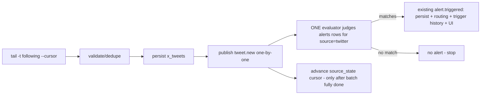

# X/Twitter Feature — Consolidated Implementation Plan (V1, Rev 2)

Status: **plan-only, locked**. Engine: `twitter-cli` (read-only), pinned. Posted 2026-09-22.
Supersedes Rev 1.

## 0. Requirements this plan commits to

1. **One alert engine only.** New tweets are stored as data; a tweet alone is NOT an alert.
   Only a tweet matching a user-configured X rule enters the existing `alert.triggered`
   pipeline. Reuse existing alert persistence, delivery, MCP notification, WebUI
   observability. A rule match is the *only* trigger path into alerting.
2. **X rules are configured via the existing MarketHub Alert system** (not hardcoded):
   keyword/phrase, handle, AND/OR keyword logic, min likes, min reposts, enabled/disabled,
   one-shot/recurring. AI creates/manages them through the existing MCP alert tools.
3. **`tweet.new` is a normal data/event signal only** — never auto-creates an alert.
4. **`twitter-cli` is pinned** (below). No unpinned future upgrade may change behavior.
5. **Replaceable adapter boundary**: `MarketHub → XTwitterService → twitter-cli`. No
   X/private-API assumptions leak into MCP, React, or core architecture.
6. **Distinct auth states**: `not_configured`, `configured`, `authenticated`,
   `expired/invalid`, `rate_limited`. Stored cookies ≠ proof of a live session.
7. **Cursor safety**: never advance the persisted feed cursor until fetched tweets are
   validated, deduped, persisted, and the required rule/eval/event work completed. No
   tweet skipped because a cursor advanced before a failed write.
8. **Durable order**: `fetch → validate/dedupe → persist → publish/evaluate configured
   rules → (matches) existing alert pipeline → advance cursor`.
9. **Polling protections**: min 60s interval; default limit 20; single CLI lock; bounded
   timeout/retry; typed auth/rate-limit/network errors; no shell, argument arrays only.
10. **$0 = no paid MarketHub API dependency in V1.** Not a guarantee the free external
    `twitter-cli` never changes or disappears.
11. **External dependency risk documented** (see §10). Graceful degradation; stored data
    stays available when X is down. No scraping workarounds/bypasses to keep the feature
    alive.
12. **Scope preservation**: 7 read-only MCP tools; React Settings panel only; no posting;
    no dashboard/tweets page; no auth/broker/event-architecture redesign; no resurrection
    of deleted plain-JS UI.
13. **Acceptance criteria** (§11) prove reliability, not just typecheck+build.

## 1. Confirmed V1 scope

- **7 read-only MCP tools**: `twitter_feed`, `twitter_search`, `twitter_tweet`,
  `twitter_article`, `twitter_bookmarks`, `twitter_user_posts`, `twitter_user_profile`.
- **X-rule management**: NO new rule tools — reuse existing generic MCP alert tools.
- **WebUI**: single `X/Twitter` settings section (credentials, poll config, X rules
  surfaced via existing Alerts UI, poll/auth status). No dashboard/tweets page.
- **Poll defaults**: interval floor 60s, default limit 20.

## 2. Pinned dependency (req 4)

| Item | Value |
|---|---|
| Repository | `https://github.com/public-clis/twitter-cli` (a.k.a. `jackwener/twitter-cli`) |
| License | Apache-2.0 (no copyleft conflict with MarketHub) |
| Pin | PyPI `twitter-cli==0.8.5` (PyPI latest; previously live-validated in this project) |
| Commit | `7c634e0d396b1e7af9f63315b414925fe4f29ae7` (2026-05-07T15:53:22Z, HEAD at pin) |
| Install | `pipx install twitter-cli==0.8.5` (NOT in PATH today; must be installed at provisioning) |
| Resolved exe | `%USERPROFILE%\.local\bin\twitter-cli.exe` (pipx layout) — resolved + verified at provisioning, stored in `x_config.cli_path` |
| Provisioning check | `twitter-cli --version` → `0.8.5`; `twitter user-posts elonmusk --max 1 --json` auth smoke |
| Change gate | Detect drift (version/path check at startup); surface `x_unavailable` state. Upgrade = deliberate, recorded in `docs/decisions.md` after re-validation. Never auto-upgrade. |
| Commands used | `feed -t following --cursor --max --full-text --json`; `search` (filters/tabs); `tweet --full-text`; `article --markdown`; `bookmarks --max --full-text --json`; `user-posts`; `user`. All read-only; `--json` non-TTY contract (SCHEMA.md). |

## 3. Architecture (req 5)

```
x_twitter/cli.py      twitter-cli adapter (subprocess, pin check, timeout, typed errors,
                      retry-on-404-once, arg arrays, env cookies/proxy, PYTHONUTF8=1)
      ▲  called only by
x_twitter/service.py  XTwitterService  (single owner of CLI + X rule evaluation)
      │  ├── on-demand reads → 7 MCP tools  (registry/contract + twitter_tools.py)
      │  ├── feed poll loop  → BackgroundTaskManager (market_analytics pattern)
      │  └── publishes tweet.new via events.publish_event (bus owns evaluation)
core/events.py        ONE publisher + ONE evaluator (existing; minor generic op extension)
core/alerts.py        ONE AlertEvaluator  ← judges tweet.new against alerts rows
alerts table (existing)  ← X rules (source="twitter") via existing TOOL_ALERT_CREATE
api/x_routes.py       REST: credentials + config + status
x_twitter/config.py   non-secret settings schema/validation
core/persistence/modules/x_twitter.py   x_tweets + x_config tables (migration v22→v23)
frontend/src/features/x/                Settings panel + status (React only)
```

- `XTwitterService` is the **only** consumer of `x_twitter/cli.py`; MCP / React / core
  never import the CLI layer (same isolation boundary pattern as news → adapters).
- Core gains **one generic capability**: string-match operators on the existing alert
  matcher (`contains`, `not_contains`, `any_of` for list fields) + corresponding entries
  in `validate_alert_definition`. No X tokens, no private-API types anywhere in core.
- Data model of X events is generic: `text`, `author`, `url`, `posted_at`, `is_retweet`,
  `metrics.likes|retweets|replies|views|bookmarks`. Nothing X-shaped crosses the adapter.

## 4. Data model (migration, precedent fno_config/news/subscriptions)

`SCHEMA_VERSION` 22→23; new `core/persistence/modules/x_twitter.py` (create + migrate),
one `elif` in `store.py:_init_db`, wired into `create_v7_schema`.

- **`x_tweets`** — `id TEXT PK` (snowflake), `handle`, `author_name`, `text`, `url`,
  `metrics` (JSON), `is_retweet`, `posted_at`, `fetched_at`. Dedup = `INSERT OR IGNORE`
  (news pattern). Retention-pruned by `retention_days` (bounded batches).
- **`x_config`** — single-row JSON (fno_config pattern): `enabled`, `poll_interval_seconds`
  (floor 60), `default_limit` (≤20), `retention_days`, `cli_path`, `proxy`, `request_delay`.
- **No new alert/rules table.** X rules are rows in the existing `alerts` table
  (`source="twitter"`, `event_type="tweet.new"`), created/updated/disabled through the
  existing alert API + `TOOL_ALERT_CREATE/LIST/GET/ENABLE/DISABLE` + AlertsSettingsPanel.
  Matching payload in `value_json`.
- Feed cursor: existing `source_state` KV (`get_source_state`/`set_source_state`,
  `source_name="twitter"`).

### X-rule representation in the existing `alerts` row
```
source="twitter", event_type="tweet.new", one_shot=<user>, consumer_id=<consumer>,
name=<user>, field_path=<e.g. "text" | "author" | "metrics.likes">,
operator=<contains | not_contains | any_of | gt | gte>,
value=<keyword | handle | [terms] | number>
```
- keyword/phrase → `field_path="text", operator="contains"`, value=str (case-insensitive)
- handle → `field_path="author", operator="contains"`, value="@handle"
- AND/OR keyword logic → `field_path="text", operator="any_of"`, value=["k1","k2"]
  (any_of = OR; AND via multiple alert rows on the same tweet, documented in UI/help)
- min likes/reposts → `field_path="metrics.likes"|"metrics.retweets"`, `gt|gte`
- enabled/disabled → existing `enabled` column via `TOOL_ALERT_ENABLE/DISABLE`
- one-shot/recurring → existing `one_shot` flag (auto-disable after trigger = existing)

## 5. Alert flow (req 1, 2, 3, 8)



- `tweet.new` is published `persistent=True, source="twitter"` through the existing
  `events.publish_event`; the existing evaluator runs it (verified: `_maybe_evaluate_alerts`
  runs on every published event, `core/events.py:461`). **A tweet alone produces no alert**
  (no alert row → no match). Only rule hits emit `alert.triggered` (existing pipeline:
  persistence, consumer routing/MCP notification, trigger history, WebUI AlertsPanel).
- One-shot rules use existing auto-disable-on-trigger; recurring rules keep firing per
  matching tweet (last_triggered_at + in-process recent-trigger cache guard replay re-fire).
- Consumers/SSE still observe `tweet.new` as ordinary data events via the same bus.

## 6. Auth states (req 6)

Derived **only** from CLI results, never from cookie presence.

| State | Derivation | Behavior |
|---|---|---|
| `not_configured` | no `auth_token`/`ct0` stored | Tools return typed `auth_required`; polling off |
| `configured` | creds present, unverified | Shown until first successful CLI call |
| `authenticated` | CLI probe/feed returns ok | Polling runs; UI green |
| `expired/invalid` | typed `not_authenticated` / 403 | Polling **pauses**; UI red chip; tools return typed error; resume attempted per cycle (no crash, no token forgery) |
| `rate_limited` | typed `rate_limited` / 429 | Backoff (exponential, capped by config); retries respect CLI `requestDelay`; UI amber |

`GET /api/x/status` returns state + timestamp + reason; cookies stored via existing
`CredentialStore.save_app_credentials("x", auth_token, ct0)` (Fernet, master.key).

## 7. Poll loop + cursor safety (req 7, 8, 9)

- Started in lifespan via `BackgroundTaskManager` (market_analytics scheduler pattern:
  `_running` flag, bounded sleep, per-cycle error isolation). Single `asyncio.Lock` — the
  loop and tool calls never run the CLI concurrently.
- **Ordering is strict** (req 8). Cursor advance (req 7) happens ONLY after the whole
  batch: fetch → validate/dedupe → persist → publish/evaluate all new tweets → cursor.
- Per-cycle `new_ids` set comes from the persist result (`INSERT OR IGNORE` return). On a
  mid-batch failure the cursor is NOT advanced; next cycle re-fetches the same window —
  already-persisted tweets are no-ops on re-persist and are excluded (`new_ids` empty) so
  their events/alerts are NOT re-fired; the remainder is completed. **No tweet is ever
  skipped because a cursor advanced before a failed write.**
- Protections: interval floor 60s; `default_limit` ≤ 20; bounded CLI timeout (per tool vs
  poll, configurable); one retry on 404 (queryId rotation) else typed error; env cookies
  + optional `TWITTER_PROXY`; `PYTHONUTF8=1`; arg arrays only, no shell.
- Pause on `expired/invalid`; backoff on `rate_limited`; loop survives and retries.

## 8. MCP tools (7 read-only; req 12)

| Tool | Source | Note |
|---|---|---|
| `twitter_feed` | DB cache (+ optional live) | following/for-you, `limit`, cursor — poll reads same rows |
| `twitter_search` | live CLI | `query`, `from`, `since`, `exclude_retweets`, `has_links`, tabs |
| `twitter_tweet` | live CLI | `url_or_id`, full text + replies |
| `twitter_article` | live CLI | long-form → markdown |
| `twitter_bookmarks` | live CLI | own saved |
| `twitter_user_posts` / `twitter_user_profile` | live CLI | on-demand handles |

Output: compact JSON→markdown; typed `is_error` codes (`not_configured`/`expired`/
`rate_limited`/`not_found`/`api_error`/`x_unavailable`). Registry + contract constants
(`TOOL_X_*`), `CONTRACT_VERSION`→2.7.0. Tools never see cookies — resolved server-side.

**X rule management**: reuse `TOOL_ALERT_CREATE/LIST/GET/ENABLE/DISABLE`
(`mcp_server/tools/alerts.py`) — no new rule MCP surface; AI creates `source="twitter"`
alert rows exactly like any other MarketHub alert.

## 9. WebUI + routes (React settings only; req 12)

- `api/x_routes.py` `build_x_routes(...)` factory → one `+ _build_x_routes(...)` term in
  `app/server.py`. Routes:
  - `GET/POST/DELETE /api/settings/x` — cookie status/save/delete (booleans only)
  - `GET/POST /api/x/config` — poll config (atomic tempfile+replace write)
  - `GET /api/x/status` — auth state + per-cycle health (last fetch/new/error/timestamp)
  - `GET /api/x/tweets?limit&filter` — read cache (used by tool + panel)
- `frontend/src/features/x/{api,useX,schemas,types,constants}.ts` + `components/XPanel.tsx`
  (settings section `x` in `SETTINGS_SECTIONS` + `SettingsView`); poll/status via
  `refetchInterval`; X rules configured in the **existing** AlertsSettingsPanel
  (source=twitter rows), no duplicate rule UI.
- No new nav page, no dashboard, no plain-JS UI.

## 10. External dependency risk (req 10, 11) — documented, not worked around

- `twitter-cli` speaks X's internal/private interfaces → **least stable component**. X can
  break it or shut the session down at any time. Pinned, never auto-upgraded; drift
  detected and surfaced.
- **Graceful failure contract**: `x_unavailable` typed state everywhere; polling pauses
  with backoff; stored `x_tweets` remain queryable offline; config/rules untouched; the
  rest of MarketHub (auth, brokers, market, news, alerts, event bus) is unaffected.
- **No scraping workarounds** (no Nitter hot-swap, no sneaky bypasses, no second client
  library) to keep the feature alive. If X access dies, the feature goes `x_unavailable`
  and data stays; revival is a deliberate, re-validated dependency decision.
- Noted `$0` means no paid MarketHub/X API in V1; the free external dependency remains a
  risk we degrade on, not fight.

## 11. Protected zones & verification gates (req 13)

### Explicit non-touch zones (unchanged from repo contract)
- `app/secrets_store.py` AUTH — call generic APIs only, never edit.
- `app/server.py` start-up composition — add one route-builder term + service wiring only.
- Existing alert **persistence/delivery/SSE/consumer/replay** code — untouched except the
  generic operator extension in `core/alerts.py` (single matcher; no new engine, no new
  tables, no X tokens).
- News/sources/brokers/condition-alert engines — untouched.

### Acceptance criteria (all must pass; suite + counts reported)
1. New tweets are stored without generating alerts.
2. Tweets matching a configured X rule generate an existing MarketHub alert
   (`alert.triggered` persistent, routed to its consumer, trigger history recorded, visible
   in AlertsPanel).
3. Non-matching tweets generate no alert.
4. AI can create/modify/disable X rules through MCP (`TOOL_ALERT_CREATE/ENABLE/DISABLE`),
   incl. keyword, handle, AND/OR, min-likes, min-reposts, one-shot/recurring.
5. Cursor survives restart without skipping tweets (simulated mid-batch failure → no loss,
   no double-fire).
6. Expired auth pauses polling safely (loop stays alive, no crash, UI state correct).
7. Rate limiting backs off safely (no hammering, configurable, typed error surfaced).
8. Existing MarketHub alert delivery unchanged (pre-existing alert fixtures still pass).
9. X failure does not corrupt stored tweets/rules (data readable offline; config intact).

### Verification gates
- `pytest test/test_architecture_boundaries.py` green.
- New tests: cli adapter (args/timeout/error-map/404-retry/pin check), poll loop
  (ordering, dedupe, cursor-on-failure semantics, pause/backoff), generic operator
  matcher (contains/not_contains/any_of + numeric), tweet.new no-alert-without-rule,
  rule→alert.triggered integration, migration 22→23 (fresh + existing DB). One bundle
  (poll ordering) has one runnable assert-based self-check.
- `bun run dev`-style full-startup smoke: server up, `/api/x/status`, feed tool once,
  X rules via MCP alert tools, alert fires.
- `git diff` read-through; only the surfaces above changed.

## 12. Deferred (deliberate)
- `twitter list`, ranked `--filter` scoring.
- Tweets dashboard page (beyond Settings).
- Per-handle lists (native following feed covers it).
- Replacing `x_rules`-as-`alerts`-rows if a dedicated rule UI is later wanted (keep rows,
  add UI only).

## 13. Build order (implementation time)
1. Migration + store facade (`x_twitter.py`, `schema.py`, `store.py`).
2. `x_twitter/{cli,config}.py` + pin/provisioning check; self-check.
3. Generic matcher operators in `core/alerts.py` (contains/not_contains/any_of).
4. `x_twitter/service.py` (reads + poll loop + publish/eval ordering + cursor safety).
5. MCP: contract/registry entries + `twitter_tools.py` (+ reuse existing alert tools).
6. `api/x_routes.py` + server wiring.
7. Frontend `features/x/` + settings section.
8. Tests, boundary suite, startup smoke, acceptance criteria §11, git diff review.